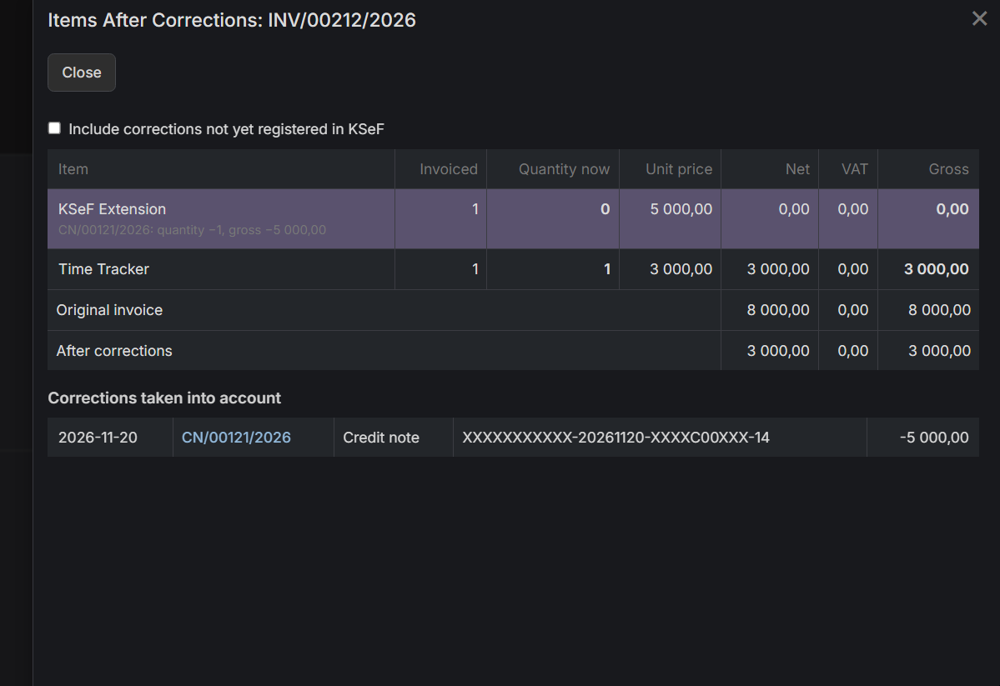

# Credit Notes in KSeF

!!! info "New in 3.0.0"
    Starting with version 3.0.0, Sales Pack Credit Notes can be issued to KSeF as correcting invoices (KOR).

## :material-calculator-variant: How corrections are sent

Corrections are sent using the **difference method**: every item of the credit note becomes one row in KSeF containing only the change, with a minus sign.

Example – an invoice for 3 monitors, the customer returns 1:

| | In EspoCRM (Credit Note) | Sent to KSeF |
|---|---|---|
| Quantity | 1 | -1 |
| Net | 100.00 | -100.00 |
| VAT 23% | 23.00 | -23.00 |
| Total | 123.00 | -123.00 |

Enter positive values in the credit note. The integration adds the minus sign automatically. VAT summaries are calculated per tax rate from the credit note items.

## :material-file-send: How to issue a correction

1. Open the invoice and create a Credit Note from it, or create a Credit Note and select the **Invoice** being corrected.
2. The KSeF profile is copied from the invoice automatically.
3. Keep only the items that change and enter the credited quantity or amount.
4. Fill in the **Reason** for the correction.
5. Optionally click `KSeF Preview` to check the correction before sending. See [Preview before sending](./invoices.md#preview-before-sending).
6. Click `Issue via KSeF`.

The corrected invoice must already have a KSeF number.

## :material-lightbulb-on-outline: Typical corrections

Below you will find what to fill in for the most common changes. In every case you start the same way: open the invoice, create a credit note from it, fill in the **Reason** and click `Issue via KSeF` at the end.

!!! tip "Several changes at once"
    You can tick more than one option in the **Changes** field, for example a new number and a new due date in one credit note.

### Wrong invoice number

The invoice was sent with a wrong number, e.g. `FV/12/2026` instead of `FV/21/2026`.

| Field | Value |
|---|---|
| Changes | **Number** only (untick **Items**) |
| Correct number of the corrected invoice | `FV/21/2026` |
| Items | none |
| Reason | Wrong invoice number |

The correction is sent with a total of **0.00**. Amounts and VAT do not change.

### Wrong dates

**Wrong issue date**

| Field | Value |
|---|---|
| Changes | **Date Invoiced** only (untick **Items**) |
| Correct issue date | the right date |
| Items | none |

The correct date is added to the reason of the correction, because KSeF has no separate field for it. Total **0.00**.

**New due date**

| Field | Value |
|---|---|
| Changes | **Due Date** only (untick **Items**) |
| Due Date | the new due date |
| Items | none |

Total **0.00**, the new due date is sent to KSeF.

**Wrong date of sale (delivery)**

| Field | Value |
|---|---|
| Changes | **Delivery Date** only (untick **Items**) |
| KSeF relevant period | **Relevant date** with the correct date of delivery or service, or **Period** with the correct start and end |
| Items | none |

The correct date (or period) is sent to KSeF as the date of sale of the correction and is also written in the reason. Total **0.00**.

### Fewer items (return)

Invoice: 10 items at 100.00 net, VAT 23%. The customer returns 3 items.

| Field in the credit note item | Value |
|---|---|
| Quantity | 3 |
| Unit price | 100.00 – **the same as on the invoice** |
| Net | 300.00 |
| VAT 23% | 69.00 |
| Total | 369.00 |

Keep **Items** ticked in **Changes** and leave only the returned item on the list. You cannot return more items than were invoiced – earlier credit notes are counted too. After this return, 7 items are left.

### Lower price (discount)

Invoice: 10 items at 100.00 net, VAT 23%. The price is reduced to 91.87.

Enter the **difference**, not the new price: 100.00 − 91.87 = **8.13** per item.

| Field in the credit note item | Value |
|---|---|
| Quantity | 10 |
| Unit price | 8.13 |
| Net | 81.30 |
| VAT 23% | 18.70 |
| Total | 100.00 |

If the discount is a single amount for the whole item, enter quantity **1** and the discount as the unit price (1 × 81.30). The VAT result is the same.

In KSeF the item is shown as a price change: the quantity stays positive and the price difference is negative (10 × −8.13). The buyer sees a discount, not returned goods.

For a price change the integration checks the value of the item, not the number of items. After this discount 918.70 is left on the item, so a later return must use the price after the discount (91.87).

!!! warning "More items or a higher price"
    Corrections increasing the amount are not available yet – see [Limitations](#limitations).

## :material-shield-check: Validation

Before saving and before sending, the integration checks that corrections do not exceed the invoice:

- each item must exist on the corrected invoice,
- the total credited amount of an item cannot exceed its invoiced amount,
- for returns (same unit price as on the invoice), the credited quantity cannot exceed the invoiced quantity,
- all previous credit notes of the invoice are included, except canceled ones.

Example: after a price reduction of 81.30 on an invoice for 10 × 100.00, a full return of 10 × 100.00 is rejected, because the remaining value is 918.70.

Before sending, the integration also checks that:

- the buyer's tax ID has not changed since the invoice was issued – a correction must name the same buyer as the corrected invoice,
- the VAT amount of every item matches its KSeF rate, the same way as for [invoices](./invoices.md#what-is-checked-before-sending). An item that changes only the VAT amount (net amount 0.00) is allowed – use it to fix VAT that was shown by mistake.

## :material-file-multiple: Several corrections to one invoice

Each correction is independent and always refers to the original invoice. You can issue as many credit notes as needed within the limits described above.

### :material-table-eye: Items after corrections

After a few corrections it is hard to tell how many units of each item and at what price are left. Open the invoice (or any of its credit notes or debit notes) and choose **Items After Corrections** from the dropdown next to the **Edit** button.

The window shows every item of the invoice with:

* the invoiced quantity and the quantity after all corrections,
* the current unit price – after a price reduction it is the average price per unit,
* net, VAT and gross after corrections,
* under the item name, the changes made by each correction, e.g. `FK/2/2026: quantity −1, gross −123.00` or `price change`.

Items changed by a correction are highlighted. Items added by a debit note are marked as such. Below the table you will find the totals of the original invoice and after corrections, and the list of corrections that were taken into account.

By default only corrections registered in KSeF (or waiting for offline delivery) are included. Tick **Include corrections not yet registered in KSeF** to see how a draft correction will change the invoice before you send it. Canceled corrections are never included.

!!! info "Return or price change?"
    A credit note item with a unit price the item already had – on the invoice or after an earlier correction – is treated as a return – the quantity goes down. An item with a different unit price is treated as a price change – the quantity stays and the value goes down. This is the same rule the integration uses when it sends the correction to KSeF.

## :material-file-edit: Corrections without item changes

If only invoice data changes (e.g. the buyer's address), clear the **Items** option in the **Changes** field and leave the credit note without items. The correction is sent with a total of 0.00.

!!! warning "Wrong tax ID"
    A wrong buyer tax ID cannot be fixed with a correction. Issue a correction to zero and a new invoice to the correct buyer.

## :material-cash-refund: Settlement after a correction

- **The invoice is not paid** – allocate the Credit Note to the Invoice, then the customer pays the remaining amount.
- **The invoice is already paid** – create an outbound payment (refund) and allocate it to the Credit Note.

The statuses change automatically to **Paid** / **Resolved** when the documents are fully settled.

## :material-alert-outline: Limitations

- Corrections increasing the amount (Debit Notes) are not sent to KSeF yet.
- Summary corrections for a period (e.g. yearly discounts) are not supported. One credit note corrects one invoice.
- Invoices issued outside KSeF (without a KSeF number) cannot be corrected through KSeF yet.
- Corrections of buyer data are sent without the "before" data section (Podmiot2K).
