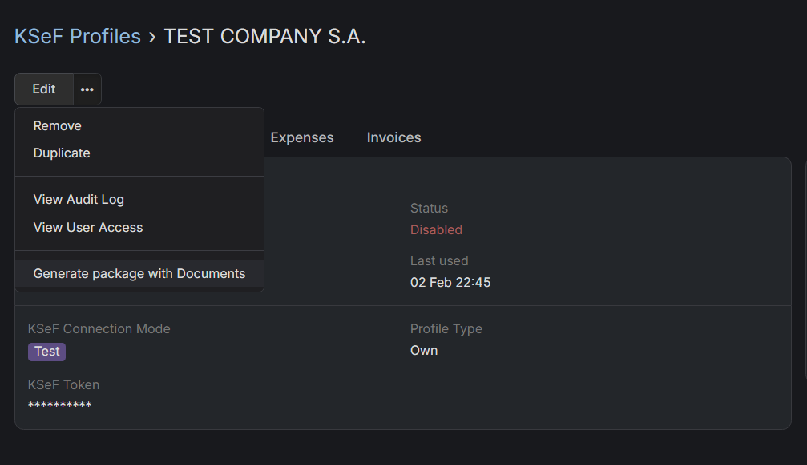

# Generate package with financial documents

## :material-download-box: How to download financial documents from previous month?

1. Go to [KSeF Profiles](https://dubas.pro/redirect/#KsefProfile).
2. Choose KSeF Profile for which you want to generate a package with documents.
3. Click on horizontal three dots icon, next to Edit button and choose `Export invoices` option from dropdown.
4. Choose period from which you want to download invoices, by default it is set to one month. You can also choose whether you want to download only expenses or invoices.
5. Click on **Export**

You'll be notified in EspoCRM notifications when package will be ready. There will be also a link to a package.

## :material-folder-zip: What is inside the package

The package is a ZIP file with up to three folders:

| Folder | Contents |
|---|---|
| `Przychodzace` | Incoming documents fetched from KSeF – invoices and corrections from your suppliers. |
| `Wychodzace` | Documents you issued in KSeF – invoices and credit notes, as XML files. |
| `UPO` | KSeF delivery confirmations (UPO) for the documents in `Wychodzace`. |

Which folders are included depends on the option you choose in step 4.

!!! info "Which documents are included"
    * Only documents that already have a KSeF number. Invoices issued in [offline mode](./offline.md) appear in the package after they are delivered to KSeF.
    * Outgoing documents are selected by their issue date, not by the date they were received by KSeF.
    * Incoming documents with the status Draft, Rejected or Canceled are skipped.
