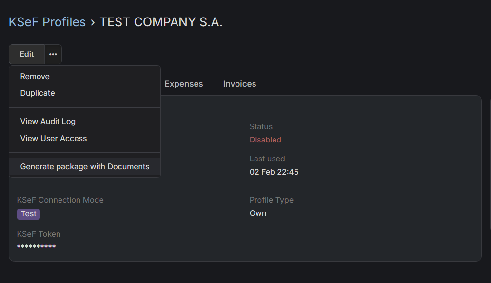

# Generowanie pakietu z dokumentami finansowymi

## :material-download-box: Jak pobrać dokumenty finansowe z poprzedniego miesiąca?

1. Przejdź do [Profili KSeF](https://dubas.pro/redirect/#KsefProfile).
2. Wybierz profil KSeF, dla którego chcesz wygenerować pakiet z dokumentami.
3. Kliknij na ikonę trzech poziomych kropek, obok przycisku Edytuj i wybierz opcję `Eksportuj faktury` z menu rozwijanego.
4. Wybierz okres, z którego chcesz pobrać faktury, domyślnie ustawiony jest na jeden miesiąc. Możesz również wybrać, czy chcesz pobrać tylko wydatki czy faktury.
5. Kliknij na **Eksportuj**

Będziesz powiadomiony w powiadomieniach EspoCRM, gdy pakiet będzie gotowy. Będzie tam również link do pakietu.

## :material-folder-zip: Co zawiera pakiet

Pakiet to plik ZIP z maksymalnie trzema folderami:

| Folder | Zawartość |
|---|---|
| `Przychodzace` | [Wydatki](./expenses.md) – faktury i korekty pobrane z KSeF oraz wydatki dodane ręcznie z załączonym plikiem. |
| `Wychodzace` | Dokumenty wystawione przez Ciebie w KSeF – faktury i faktury korygujące, w formacie XML. |
| `UPO` | Urzędowe Poświadczenia Odbioru (UPO) z KSeF dla dokumentów z folderu `Wychodzace`. |

To, które foldery znajdą się w pakiecie, zależy od opcji wybranej w kroku 4.

!!! info "Jakie dokumenty trafiają do pakietu"
    * Dokumenty wychodzące: tylko te, które mają już numer KSeF. Faktury wystawione w [trybie offline](./offline.md) pojawią się w pakiecie po dosłaniu ich do KSeF.
    * Dokumenty wychodzące są wybierane według daty wystawienia, a nie daty przyjęcia w KSeF.
    * Wydatki ze statusem Wersja robocza, Odrzucony lub Anulowany są pomijane.
    * Wydatek dodany ręcznie trafia do pakietu, gdy jest przypisany do eksportowanego profilu KSeF i ma dokument w polu **Załącznik**. Pliki z pola **Załączniki** nie są dołączane.
