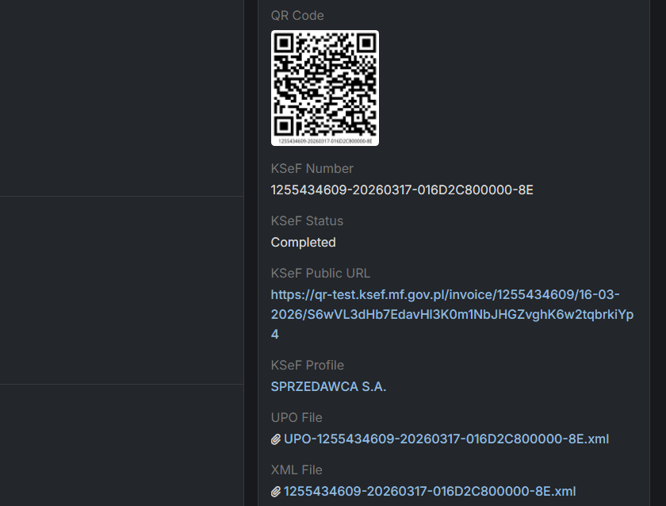
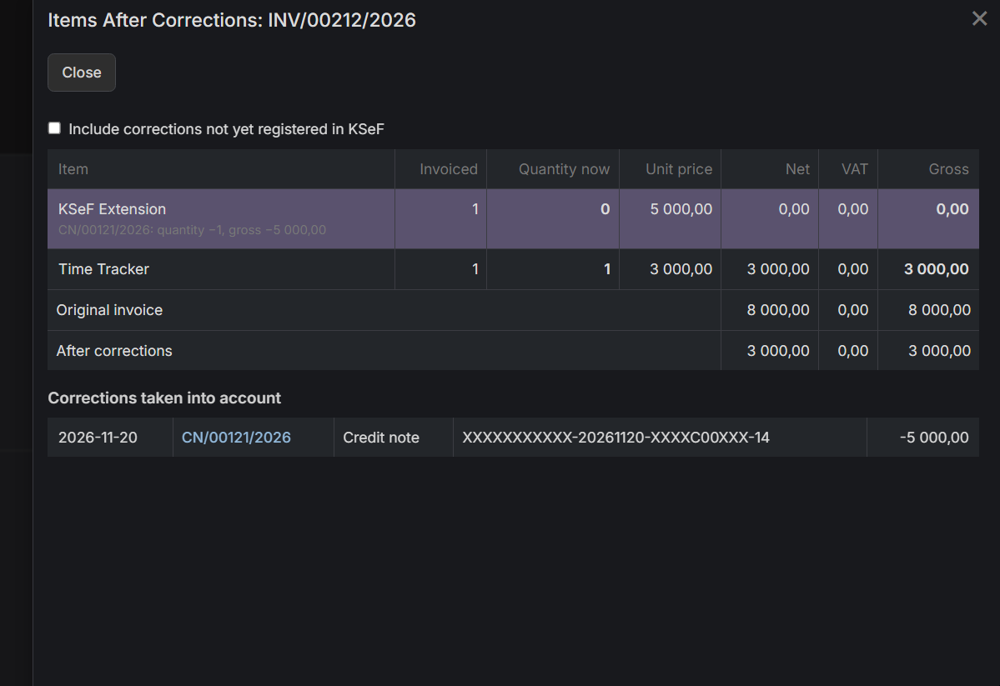

# Invoices Management



## :material-file-send: How to issue Invoice via KSeF?

??? warning "Sales Pack required"
    Please keep in mind that feature will not work if you don't have Sales Pack extension.

??? info "Enable invoices first"
    This feature will only work if you enable invoices in KSeF profile (details above).

!!! danger "Review issued invoice!"
    Please keep in mind that software may contain bugs and mistakes. Check your specific usecase with [test profile](./test-profile.md) before you start using with production KSeF Profile.

1. Go to **Invoices**.
2. Create new Invoice.
3. Choose KSef Profile.
4. Optionally click `KSeF Preview` to check how the invoice will look in KSeF.
5. Click on `Issue via KSeF`
6. After everything is fine, invoice will be scheduled for sending to KSeF.

Unfortunatelly we can't pass invoice to KSeF in few seconds, that's why it's working in background. After invoice will be issued, field KSeF Status will be set to **Completed**.

### When button `Issue via KSeF` will be visible?

Button is visible only when all of the following conditions are met:

- The record view is **not in edit mode**.
- Invoice `status` is **not** one of: `Issued`, `Paid`, `Overdue`, `Confirmed`.
- `ksefStatus` is either:
    - `null`, or
    - a string containing `"Error"`.
- `ksefProfileId` is **not** `null`.

If any of these checks fail, the button is hidden.

## :material-eye: Preview before sending

You can prepare an invoice as a draft and check it before you issue it. Click `KSeF Preview` to see the invoice exactly as it would be sent to KSeF right now: seller, buyer, items, VAT summary, annotations and payment details. The preview opens in a new browser tab and nothing is sent to KSeF. If something is wrong, correct the invoice and open the preview again.

* If something is missing or wrong, the preview shows the same message you would get when sending, so you can fix it first.
* To save the preview as PDF, use **Print** in your browser (`Ctrl+P`) and choose **Save as PDF**. The printout is marked as a preview.
* You can preview a draft with any date. The preview reminds you that the issue date must be today when you issue the invoice.
* After the invoice is issued, the preview shows it exactly as it was issued – with its KSeF number, or with the delivery deadline for [offline mode](./offline.md).
* The preview uses the same light or dark look as your EspoCRM theme. Printouts are always light.

The button is available on invoices, debit notes and credit notes, before and after issuing.

!!! note
    The preview is for EspoCRM users only, to check the data. It is not an invoice or an official KSeF visualisation, so do not send it to the buyer.

## :material-shield-check: What is checked before sending

Before an invoice goes to KSeF, the integration checks that it is complete and consistent. If something is wrong, the invoice is not sent, the KSeF Status changes to **Error obtaining fields for submission** and you see the reason. Fix the data and click `Issue via KSeF` again.

| Check | What to do if it fails |
|---|---|
| The invoice date is today. | Set the invoice date to today's date. |
| The buyer has a tax ID type selected. | Choose the type on the Account – for consumers choose **Private person**. See [Accounts](./accounts.md). |
| The VAT amount of every item matches its KSeF rate. | Check the item's tax code – its rate in EspoCRM must agree with the selected **KSeF Rate**. See [Tax rates](./tax-rates.md). |
| Items marked as exempt (`zw`) have the legal basis of the exemption. | Fill in **Exemption Type** and **Exemption Description** on the invoice. |
| Items with `0% WDT` (intra-community supply) have a buyer with an EU VAT number. | Set the buyer's tax ID type to **VAT UE**. |
| **Reverse Charge** is ticked only when the invoice has reverse-charge items (`oo` or `np II`). | Untick the option or correct the tax codes. |
| A buyer in a VAT group has the group member added. | Add the member in **Additional Accounts** with the role **VAT group member - recipient**. |

!!! tip "Reverse charge is marked automatically"
    You do not have to tick **Reverse Charge** yourself. When the invoice contains items with the `oo` or `np II` rate, the "odwrotne obciążenie" annotation is added automatically.

## :material-lock: After the invoice is in KSeF

An invoice registered in KSeF cannot be changed – this is required by law. Amounts, items, buyer data and other information sent to KSeF are locked in EspoCRM. If anything needs to change, issue a [credit note](./credit-notes.md).

## :material-wifi-off: When KSeF is unavailable

If KSeF does not respond while an invoice is being sent, the integration can issue it in **offline mode**. See [Offline mode](./offline.md) for details.

## :material-book-information-variant: KSeF fields in invoices

- `ksefNumber` - KSeF number assigned to an invoice. Required on issued invoices.
- `ksefStatus` - status of invoice delivery to KSeF.
- `ksefPublicUrl` - public url to status page of invoice in KSeF.
- `ksefProfile` - profile which is used to issue an invoice and pass to KSeF.
- `upoFile` - XML file which confirm delivery to KSeF.
- `xmlFile` - XML file which contains invoice details.

## :material-bank-plus: How to set additional params for invoice?

Go to Layout manager and add proper fields into the detail view:

- Additional Accounts - you can add third party accounts to invoice and set their role
- Cash Method
- Reverse Charge
- Split Payment Mechanism
- Excemption Type - you can set also `Excemption Description`. Required when the invoice has exempt (`zw`) items
- Relevant Period - if you want to specify different date than issuance, choose `Relevant Date` or `Period`. In such scenario, add also additional fields: `Date of Delivery or Service Completion` or/and `Period Start Date` and `Period End Date`

## :material-format-list-bulleted: Item details sent to KSeF



Besides the name, quantity and price, each invoice item can carry additional details. Some are sent always when filled in, others only when enabled in the KSeF profile.

| Detail | Where to enter it | Sent to KSeF |
|---|---|---|
| Unit of measure | **Unit of Measure** column of the item, or **Unit of Measure** on the Product | Always. When empty, `szt.` is used. |
| GTU code | **GTU** column of the item, or **GTU** on the Product | Always when filled in. |
| PKWiU | **PKWiU** column of the item, or **PKWiU** on the Product | Always when filled in. |
| Item description | **Description** of the item | Only when **Product description** is selected in the profile. |
| Serial number | **Serial Number** of the item | Only when **Product Serial Number** is selected in the profile. |

Values entered on the item take priority. When the item field is empty, the value is taken from the selected Product, so it is enough to set the unit, GTU and PKWiU once on the product card (KSeF panel on the Product).

### How to send item descriptions and serial numbers

1. Open **Administration → KSeF Settings** and the KSeF profile used for invoicing.
2. In the **Invoices** section, add **Product description** and/or **Product Serial Number** to **Additional Information**.
3. Save the profile.
4. Serial numbers are not visible on the item list by default. Add the **Serial Number** field to the Invoice Item list layout in **Administration → Layout Manager**, and do the same for Credit Note Items if you correct such items.

Descriptions and serial numbers are sent in the additional description section (`DodatkowyOpis`) and linked to the item row number, so the buyer sees which item they belong to. Check the result with the [KSeF Preview](#preview-before-sending) before sending.

!!! note
    The additional information options apply to all invoices issued with the profile. Items without a description or serial number are simply skipped.

## :material-file-sign: Contract number

If the invoice relates to a contract, fill in **Contract Number** and **Contract Date** on the **KSeF** tab, in the **Transaction Terms** panel. Both fields are optional – you can enter only the number, only the date, or both. They are sent to KSeF in the transaction terms of the invoice and shown in the preview. When nothing is entered, the transaction terms are not sent at all.

A credit note takes over the contract number and date from the corrected invoice unless you enter different ones. After the invoice is registered in KSeF, both fields are locked.

## :material-currency-usd: How to issue invoices in different currencies?

1. Enable additional [currencies in settings](https://dubas.pro/redirect/#Admin/currency)
2. Enter proper [currency rates](https://dubas.pro/redirect/#CurrencyRecord/list/fromSettings=true) for each currency - you can also do it automatically (check out below)
3. While creating new invoice, before adding anything to item list, change currency from PLN to something else

## :material-github: How to automatically update currency rates?

You can download our free extension to keep updated currency rates:
<a href="https://github.com/dubas-pro/ext-nbp-exchange-rates/releases">NBP Extension</a>


## :material-qrcode-scan: How to properly label PDF invoice

!!! warning
    Please make sure the PDF displays accurate details that match the information sent to KSeF.

If you want to provide your customer with a PDF visualization of an invoice issued via KSeF, make sure the PDF contains values consistent with data sent to KSeF.

Include at least:

- **KSeF number** - `{{ksefNumber}}`
- **Public link to the KSeF invoice page** - `{{ksefPublicUrl}}`
- **QR code for the KSeF public invoice page** `{{qrCodeId}}`

For invoices issued in **offline mode**, include an additional (second) QR code required for offline identification/verification. It is stored in the `qrCodeCertificate` field. See [Offline mode](./offline.md).

### How to print QR Code on PDF?

You can use barcode generated by KSeF integration which is stored in invoice (field `qrCodeId`) or you can generate your own QR Code with link to adjust barcode design:


```handlebars
{{barcodeImage ksefPublicUrl_RAW type='QRcode' width=60 height=60 fontsize=14 text=false padding=2}}
```
