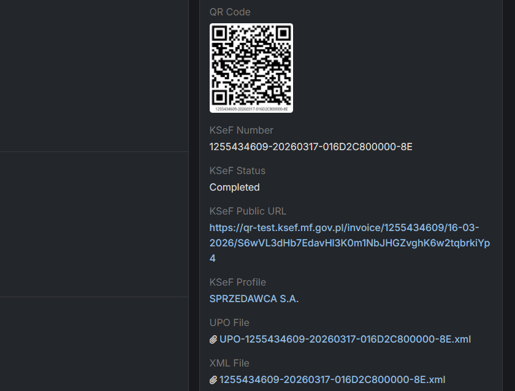

# Zarządzanie Fakturami



## :material-file-send: Jak wystawić Fakturę za pośrednictwem KSeF?

??? warning "Wymagany pakiet Sales Pack"
    Pamiętaj, że ta funkcja nie będzie działać, jeśli nie masz zainstalowanego rozszerzenia Sales Pack.

??? info "Najpierw włącz faktury"
    Ta funkcja będzie działać tylko, jeśli włączysz faktury w profilu KSeF (szczegóły powyżej).

!!! danger "Przejrzyj wystawioną fakturę!"
    Pamiętaj, że oprogramowanie może zawierać błędy. Sprawdź swoją konkretną konfigurację przy użyciu [profilu testowego](./test-profile.md) przed użyciem profilu KSeF w produkcji.

1. Przejdź do **Faktur**.
2. Utwórz nową Fakturę.
3. Wybierz Profil KSeF.
4. Opcjonalnie kliknij `Podgląd KSeF`, aby sprawdzić, jak faktura będzie wyglądać w KSeF.
5. Kliknij na `Wystaw przez KSeF`
6. Jeśli wszystko jest w porządku, faktura zostanie zaplanowana do wysłania do KSeF.

Niestety nie możemy przesłać faktury do KSeF w ciągu kilku sekund, dlatego proces działa w tle. Po wystawieniu faktury pole Status KSeF zostanie ustawione na **Zakończona**.

### Kiedy przycisk `Wystaw przez KSeF` będzie widoczny?

Przycisk jest widoczny tylko wtedy, gdy spełnione są wszystkie następujące warunki:

- Widok rekordu **nie jest w trybie edycji**.
- Status faktury `status` **nie jest** jednym z: `Issued`, `Paid`, `Overdue`, `Confirmed`.
- `ksefStatus` to albo:
    - `null`, albo
    - string zawierający `"Error"`.
- `ksefProfileId` **nie jest** `null`.

Jeśli którekolwiek z tych warunków nie zostaną spełnione, przycisk będzie ukryty.

## :material-eye: Podgląd przed wysyłką

Fakturę możesz przygotować wstępnie i sprawdzić przed wystawieniem. Kliknij `Podgląd KSeF`, aby zobaczyć fakturę dokładnie w takiej postaci, w jakiej trafiłaby teraz do KSeF: sprzedawcę, nabywcę, pozycje, podsumowanie VAT, adnotacje i dane płatności. Podgląd otwiera się w nowej karcie przeglądarki i nic nie jest wysyłane do KSeF. Jeśli coś się nie zgadza, popraw fakturę i otwórz podgląd ponownie.

* Jeśli czegoś brakuje lub coś się nie zgadza, podgląd pokaże ten sam komunikat, który pojawiłby się przy wysyłce – możesz to poprawić wcześniej.
* Aby zapisać podgląd jako PDF, użyj **Drukuj** w przeglądarce (`Ctrl+P`) i wybierz **Zapisz jako PDF**. Wydruk jest oznaczony jako podgląd.
* Podgląd działa dla wersji roboczej z dowolną datą. Przypomina tylko, że w chwili wystawienia data wystawienia musi być dzisiejsza.
* Po wystawieniu podgląd pokazuje dokument dokładnie w takiej postaci, w jakiej został wystawiony – z numerem KSeF albo z terminem przesłania dla [trybu offline](./offline.md).
* Podgląd ma jasny lub ciemny wygląd, tak jak Twój motyw EspoCRM. Wydruk jest zawsze jasny.

Przycisk jest dostępny na fakturach, notach obciążeniowych (Debit Note) i korektach, przed wystawieniem i po nim.

!!! note
    Podgląd jest przeznaczony tylko dla użytkowników EspoCRM do sprawdzenia danych. Nie jest fakturą ani oficjalną wizualizacją KSeF – nie przekazuj go nabywcy.

## :material-shield-check: Co jest sprawdzane przed wysyłką

Zanim faktura trafi do KSeF, integracja sprawdza, czy jest kompletna i spójna. Jeśli coś się nie zgadza, faktura nie zostanie wysłana, Status KSeF zmieni się na **Błąd podczas pobierania pól do wysyłki**, a Ty zobaczysz przyczynę. Popraw dane i ponownie kliknij `Wystaw przez KSeF`.

| Co jest sprawdzane | Co zrobić, gdy sprawdzenie nie przejdzie |
|---|---|
| Data wystawienia faktury to dzisiejsza data. | Ustaw dzisiejszą datę wystawienia. |
| Nabywca ma wybrany typ identyfikatora podatkowego. | Wybierz typ na Koncie – dla konsumentów **Osoba prywatna**. Zobacz [Konta](./accounts.md). |
| Kwota VAT każdej pozycji zgadza się z jej stawką KSeF. | Sprawdź kod podatkowy pozycji – stawka w EspoCRM musi odpowiadać wybranej **Stawce KSeF**. Zobacz [Stawki podatkowe](./tax-rates.md). |
| Pozycje zwolnione (`zw`) mają podaną podstawę prawną zwolnienia. | Uzupełnij na fakturze **Typ zwolnienia** i **Opis zwolnienia**. |
| Pozycje `0% WDT` (wewnątrzwspólnotowa dostawa towarów) mają nabywcę z numerem VAT UE. | Ustaw typ identyfikatora nabywcy na **VAT UE**. |
| **Odwrotne obciążenie** jest zaznaczone tylko wtedy, gdy faktura ma pozycje z odwrotnym obciążeniem (`oo` lub `np II`). | Odznacz opcję albo popraw kody podatkowe. |
| Nabywca będący grupą VAT ma dodanego członka grupy. | Dodaj członka w **Dodatkowych podmiotach** z rolą **Członek grupy VAT - odbiorca**. |

!!! tip "Odwrotne obciążenie oznaczane automatycznie"
    Nie musisz samodzielnie zaznaczać **Odwrotnego obciążenia**. Gdy faktura zawiera pozycje ze stawką `oo` lub `np II`, adnotacja „odwrotne obciążenie” jest dodawana automatycznie.

## :material-lock: Po wysłaniu faktury do KSeF

Faktury zarejestrowanej w KSeF nie można zmienić – tak stanowią przepisy. Kwoty, pozycje, dane nabywcy i pozostałe informacje wysłane do KSeF są w EspoCRM zablokowane. Jeśli cokolwiek wymaga zmiany, wystaw [fakturę korygującą](./credit-notes.md).

## :material-wifi-off: Gdy KSeF jest niedostępny

Jeśli KSeF nie odpowiada podczas wysyłki faktury, integracja może wystawić ją w **trybie offline**. Szczegóły znajdziesz w artykule [Tryb offline](./offline.md).

## :material-book-information-variant: Pola KSeF na fakturach

- `ksefNumber` - numer KSeF przypisany do faktury. Wymagane na wystawionych fakturach.
- `ksefStatus` - status dostarczenia faktury do KSeF.
- `ksefPublicUrl` - publiczny adres URL strony statusu faktury w KSeF.
- `ksefProfile` - profil używany do wystawienia faktury i przesłania do KSeF.
- `upoFile` - plik XML potwierdzający dostarczenie do KSeF.
- `xmlFile` - plik XML zawierający szczegóły faktury.

## :material-bank-plus: Jak ustawić dodatkowe parametry faktury?

Przejdź do menadżera layoutu i dodaj odpowiednie pola do widoku szczegółów:

- Dodatkowe Konta - możesz dodać konta stron trzecich do faktury i ustawić ich rolę
- Metoda Kasowa
- Odwrotne Obciążenie
- Mechanizm Podzielonej Płatności
- Typ Zwolnienia - możesz również ustawić `Opis Zwolnienia`. Wymagane, gdy faktura zawiera pozycje zwolnione (`zw`)
- Okres Istotny - jeśli chcesz określić inną datę niż wystawienie, wybierz `Datę Istotną` lub `Okres`. W takim przypadku dodaj również dodatkowe pola: `Data Dostarczenia lub Wykonania Usługi` lub/i `Data Początkowa Okresu` i `Data Końcowa Okresu`

## :material-currency-usd: Jak wystawiać faktury w różnych walutach?

1. Włącz dodatkowe [waluty w ustawieniach](https://dubas.pro/redirect/#Admin/currency)
2. Wprowadź odpowiednie [kursy walut](https://dubas.pro/redirect/#CurrencyRecord/list/fromSettings=true) dla każdej waluty - możesz to również robić automatycznie (sprawdź poniżej)
3. Podczas tworzenia nowej faktury, przed dodaniem czegokolwiek do listy pozycji, zmień walutę z PLN na inną

## :material-github: Jak automatycznie aktualizować kursy walut?

Możesz pobrać nasze darmowe rozszerzenie, aby utrzymywać aktualne kursy walut:
<a href="https://github.com/dubas-pro/ext-nbp-exchange-rates/releases">Rozszerzenie NBP</a>


## :material-qrcode-scan: Jak prawidłowo opisać fakturę PDF

!!! warning
    Upewnij się, że PDF wyświetla dokładne szczegóły, które są zgodne z informacjami wysłanymi do KSeF.

Jeśli chcesz dostarczyć klientowi wizualizację PDF faktury wystawionej za pośrednictwem KSeF, upewnij się, że PDF zawiera wartości zgodne z danymi wysłanymi do KSeF.

Uwzględnij co najmniej:

- **Numer KSeF** - `{{ksefNumber}}`
- **Link publiczny do strony faktury KSeF** - `{{ksefPublicUrl}}`
- **Kod QR dla publicznej strony faktury KSeF** `{{qrCodeId}}`

Dla faktur wystawionych w **trybie offline**, uwzględnij dodatkowy (drugi) kod QR wymagany do identyfikacji/weryfikacji offline. Jest zapisany w polu `qrCodeCertificate`. Zobacz [Tryb offline](./offline.md).

### Jak wydrukować kod QR na PDF?

Możesz użyć kodu kreskowego wygenerowanego przez integrację KSeF, który jest przechowywany na fakturze (pole `qrCodeId`), lub możesz wygenerować własny kod QR ze łączem do dostosowania projektu kodu kreskowego:


```handlebars
{{barcodeImage ksefPublicUrl_RAW type='QRcode' width=60 height=60 fontsize=14 text=false padding=2}}
```
