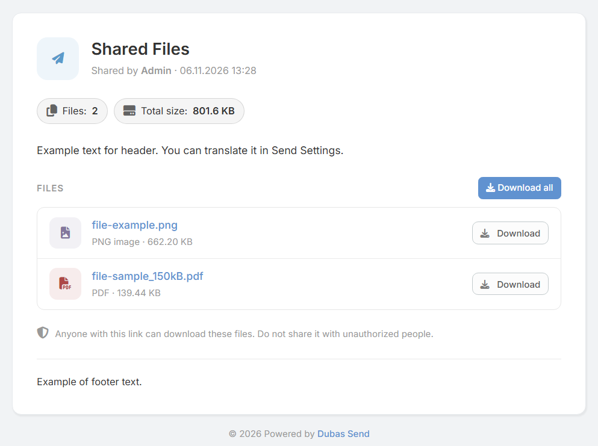

# Dubas Send Erweiterung für EspoCRM

## :material-information-outline: Allgemeine Informationen

**Dubas Send** ist eine professionelle Erweiterung für EspoCRM zur sicheren und kontrollierten Freigabe von Dateien und Textnotizen an Kunden und Geschäftspartner. Über eindeutige, geschützte URLs können Sie Ablaufdaten, Download-Limits und Zugriffsrechte präzise festlegen.

!!! info "Produktseite"
    Weitere Informationen und Kaufoptionen finden Sie unter: [devcrm.it/send](https://devcrm.it/send)

---

## :material-playlist-check: Systemvoraussetzungen

| Anforderung | Mindestversion |
| :--- | :--- |
| **EspoCRM** | v8.3.0 oder höher |
| **PHP** | v8.1 oder höher |
| **Netzwerk-Erreichbarkeit** | Öffentlich erreichbare EspoCRM-Instanz für externen Kundenzugriff. |

---

## :material-book-plus-multiple: Schnellstart: Dateifreigabe erstellen

1. Öffnen Sie das Modul **Sends**.
2. Klicken Sie auf **Send erstellen**.
3. Wählen Sie einen übergeordneten Datensatz (z. B. *Account*, *Opportunity*) oder fügen Sie direkt Dateien/Notizen hinzu.
4. Klicken Sie auf **Speichern**.
5. Kopieren Sie die generierte **Public URL** und senden Sie diese an Ihren Kunden.

---

## :material-cube-scan: Demo-Instanz

Testen Sie die Erweiterung auf unserer Demo-Umgebung:
* **Demo-URL:** [demo.devcrm.it](https://demo.devcrm.it)
* **Benutzername:** `send`
* **Passwort:** `dubas`

---

## :material-video-box: Videopräsentation

  <iframe width="1280" height="400" src="https://www.youtube.com/embed/Jrw-05MuTQg" frameborder="0" allowfullscreen></iframe>

