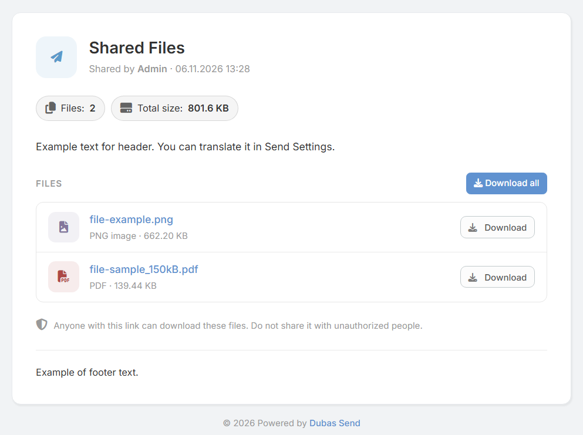

# Dubas Send Extension for EspoCRM

## :material-information-outline: General Information

**Dubas Send** is a powerful extension for EspoCRM designed to securely share files and text notes with customers and external partners. It generates secure, unique public URLs while allowing administrators and users to configure expiration dates, download limits, and strict access controls.

!!! info "Product Page"
    Official product page and commercial details: [devcrm.it/send](https://devcrm.it/send)

---

## :material-playlist-check: System Requirements

Ensure your environment meets the following prerequisites before installation:

| Requirement | Minimum Version |
| :--- | :--- |
| **EspoCRM** | v8.3.0 or higher |
| **PHP** | v8.1 or higher |
| **Network Reachability** | Publicly accessible EspoCRM instance for external customer access. |

---

## :material-book-plus-multiple: Quick Start: How to Share Files

1. Navigate to the **Sends** module.
2. Click **Create Send**.
3. Select a parent record (e.g., *Account*, *Opportunity*, *Case*) or directly attach files / enter a note.
4. Click **Save**.
5. Copy the generated **Public URL** and share it with your customer.

---

## :material-cube-scan: Demo Instance

Test the extension live on our demo environment:
* **Demo URL:** [demo.devcrm.it](https://demo.devcrm.it)
* **Username:** `send`
* **Password:** `dubas`

---

## :material-video-box: Video Presentation

  <iframe width="1280" height="400" src="https://www.youtube.com/embed/Jrw-05MuTQg" frameborder="0" allowfullscreen></iframe>

