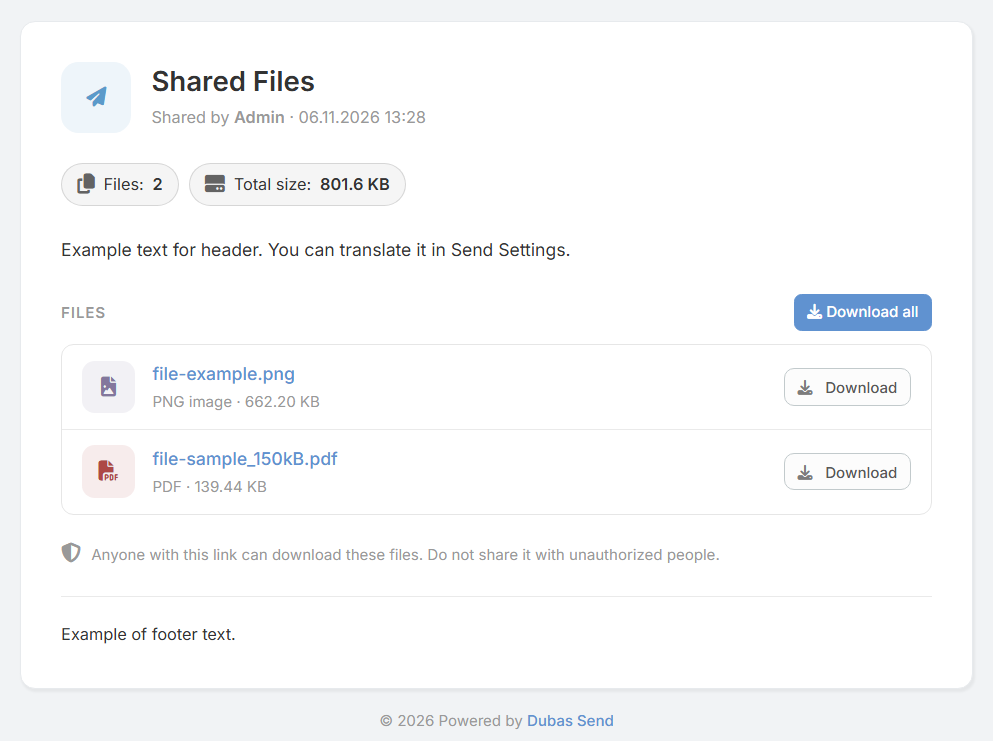

# Rozszerzenie Dubas Send dla EspoCRM

## :material-information-outline: Informacje ogólne

**Dubas Send** to zaawansowane rozszerzenie dla systemu EspoCRM, stworzone z myślą o bezpiecznym i kontrolowanym udostępnianiu plików oraz informacji tekstowych klientom i partnerom biznesowym. Rozszerzenie generuje unikalne, zabezpieczone odnośniki (URL), pozwalając precyzyjnie zdefiniować czas dostępności zasobów, limity pobrań oraz poziomy uprawnień dostępu.

!!! info "Strona produktu"
    Szczegółowe informacje handlowe oraz możliwość zakupu znajdują się na stronie: [devcrm.it/send](https://devcrm.it/send)

---

## :material-playlist-check: Wymagania systemowe

Przed instalacją rozszerzenia upewnij się, że Twoje środowisko spełnia następujące wymagania:

| Wymaganie | Minimalna wersja |
| :--- | :--- |
| **EspoCRM** | v8.3.0 lub nowsza |
| **PHP** | v8.1 lub nowsza |
| **Dostępność sieciowa** | Instancja EspoCRM musi posiadać publiczny adres URL dostępu zewnętrznego. |

---

## :material-book-plus-multiple: Szybki start: Jak udostępnić plik?

1. Przejdź do nawigacji i wybierz moduł **Sends**.
2. Kliknij przycisk **Utwórz Send**.
3. Powiąż wpis z rekordem nadrzędnym (np. *Account*, *Opportunity*, *Case*) lub bezpośrednio załącz pliki / wpisz notatkę dla odbiorcy.
4. Zapisz rekord.
5. Skopiuj wygenerowany **Public URL** i przekaż go odbiorcy.

---

## :material-cube-scan: Wersja demonstracyjna

Możesz przetestować działanie rozszerzenia na naszej instancji demo:
* **Adres demo:** [demo.devcrm.it](https://demo.devcrm.it)
* **Użytkownik:** `send`
* **Hasło:** `dubas`

---

## :material-video-box: Prezentacja wideo

  <iframe width="1280" height="400" src="https://www.youtube.com/embed/Jrw-05MuTQg" frameborder="0" allowfullscreen></iframe>

