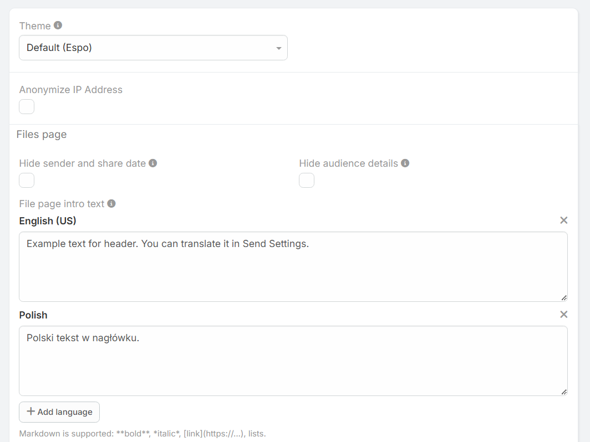

# Zarządzanie modułem Send

Moduł **Send** odpowiada za przechowywanie oraz zarzadzanie wszystkimi utworzonymi udostępnieniami. Każdy rekord reprezentuje unikalną paczkę plików lub notatkę przeznaczoną dla określonego odbiorcy.

!!! example "Przejdź do modułu"
    [#Send](https://dubas.pro/redirect/#Send)

---

## Szczegółowy opis pól rekordu Send

| Pole | Nazwa techniczna | Opis |
| :--- | :--- | :--- |
| **Nazwa** | `name` | Tytuł identyfikujący dane udostępnienie w systemie. |
| **Rekord nadrzędny** | `parent` / `parentType`, `parentId` | Powiązanie z encją nadrzędną (np. *Account*, *Opportunity*, *Email*, *Note*). |
| **Data wygaszania** | `expiryDate` | Data i godzina, po której link przestanie działać. Wygasłe linki zwracają błąd 404. |
| **Status** | `status` | Stan udostępnienia (np. *Active*, *Expired*, *Disabled*). |
| **Notatka** | `note` | Treść wiadomości tekstowej prezentowanej odbiorcy na stronie udostępnienia. |
| **Załączniki** | `attachments` | Lista plików ręcznie powiązanych z danym udostępnieniem. |
| **Język** | `language` | Wersja językowa interfejsu strony udostępnienia prezentowanej odbiorcy. |
| **Maksymalna liczba dostępu** | `maximumAccessCount` | Limit pobrań/wyświetleń linku. Wartość `0` oznacza brak limitu. |
| **Poziom dostępu** | `accessLevel` | Określa wymagania autoryzacyjne dla odbiorcy (zobacz sekcję niżej). |
| **Wymuś widok listy** | `forceListView` | Gdy zaznaczone, strona zawsze wyświetli listę plików (nawet przy pojedynczym pliku). |
| **Wymuś pobieranie pliku** | `forceFileDownload` | Przy pojedynczym pliku wymusza bezpośrednie pobranie z pominięciem strony podglądu. |
| **Publiczny URL** | `publicUrl` | Unikalny adres internetowy generowany automatycznie, przekazywany klientowi. |
| **Token dostępu** | `accessToken` | Unikalny hash zabezpieczający dostęp do zasobu. |
| **Licznik dostępu** | `accessCount` | Rzeczywista liczba otwarć/pobrań zrealizowanych przez odbiorców. |

---

## Poziomy dostępu (`accessLevel`)

Rozszerzenie umożliwia precyzyjne ograniczenie kręgu odbiorców pliku:

* **Public (anyone with the link):** Dostęp otwarty dla każdego posiadacza linku.
* **Internal:** Dostęp wyłącznie dla zalogowanych użytkowników wewnętrznych systemu CRM.
* **Portal:** Dostęp ograniczony do zalogowanych użytkowników Portalu Klienta.
* **Authenticated:** Dostęp dla dowolnego zalogowanego użytkownika (CRM lub Portal).

!!! note "Powiązanie z Kontem (Account)"
    Jeśli wybrano dostęp typu `Portal` lub `Authenticated`, a rekord Send jest powiązany z konkretnym Kontem (*Account*), system zezwoli na dostęp wyłącznie tym użytkownikom portalu, którzy są przypisani do danego Konta.
