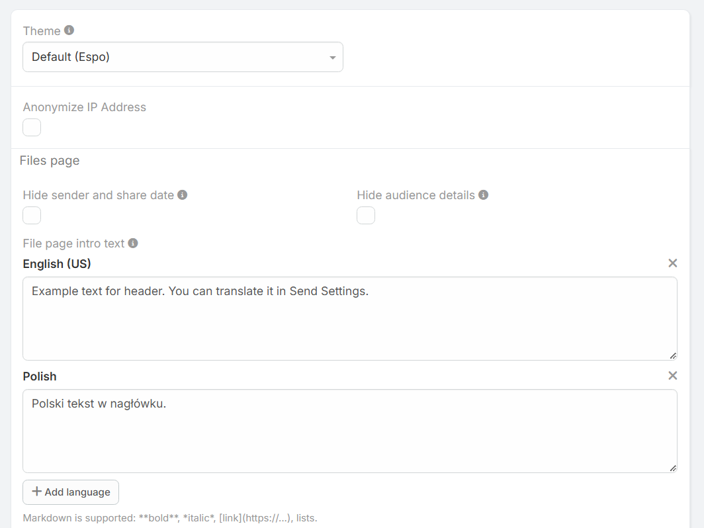

# Einstellungen der Erweiterung (Send Settings)

Sie erreichen die Einstellungen unter:
**Administration » Send Settings**.

!!! example "Weiterleitung zu den Einstellungen"
    [#Admin/dubasSend](https://dubas.pro/redirect/#Admin/dubasSend)

---

## Option Übersicht

### Allgemeine Einstellungen
* **Theme:** Auswahl des visuellen Themes für Freigabeseiten.
* **Anonymize IP Address:** Anonymisiert IP-Adressen der Empfänger in den Zugriffsprotokollen.

### Konfiguration der Dateiseite
* **Hide sender and share date:** Blendet den Absender und das Erstellungsdatum im Header aus.
* **Zielgruppen-Info ausblenden (`dubasSendAudienceInfoDisabled`):** Blendet Hinweise zur Zielgruppe auf Sperrseiten aus.
* **File page intro text:** Mehrsprachiger Einleitungstext für die Freigabeseite. Unterstützt **Markdown**.
* **File page footer text:** Mehrsprachiger Fußzeilentext für die Freigabeseite. Unterstützt **Markdown**.

!!! tip "Mehrsprachigkeit"
    Über die Schaltfläche **+ Add language** können Sie spezifische Texte für verschiedene Sprachen hinterlegen.
