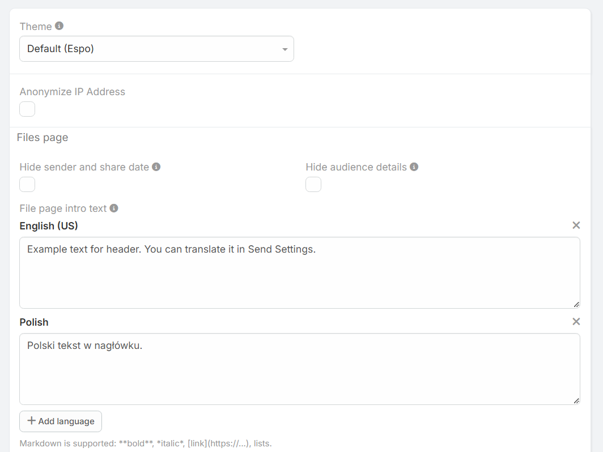

# Send Extension Settings

Access global settings via:
**Administration » Send Settings**.

!!! example "Redirect to settings"
    [#Admin/dubasSend](https://dubas.pro/redirect/#Admin/dubasSend)

---

## Configuration Options

### General Settings
* **Theme:** Select the visual theme for public file pages.
* **Anonymize IP Address:** When enabled, recipient IP addresses are omitted from access logs.

### Files Page Configuration
* **Hide sender and share date:** Suppresses the sender's identity (e.g., *Admin*) and creation timestamp from the public header.
* **Hide intended audience (`dubasSendAudienceInfoDisabled`):** Suppresses target audience badges (e.g., *Intended for: All logged-in users*) on restriction pages.
* **File page intro text:** Multi-language header message displayed at the top of file pages. Supports **Markdown**.
* **File page footer text:** Multi-language footer message displayed at the bottom of file pages. Supports **Markdown**.

!!! tip "Multi-Language Support"
    Add localized header and footer text for multiple languages using the **+ Add language** button.
