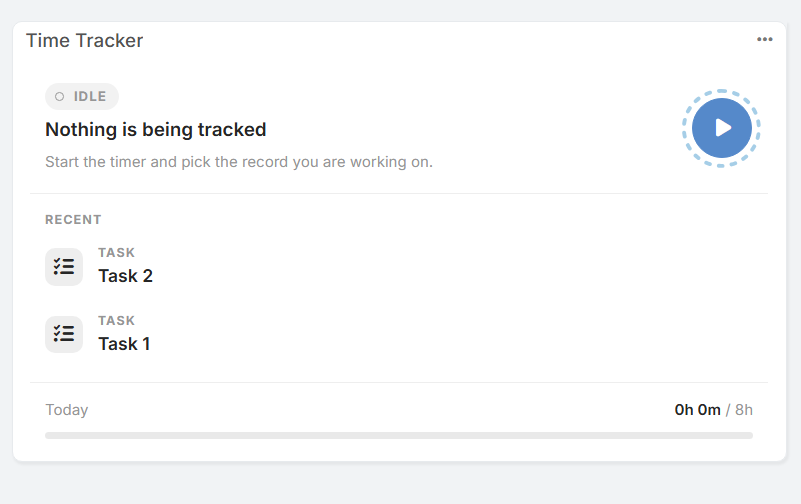
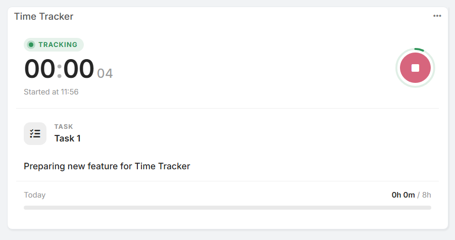
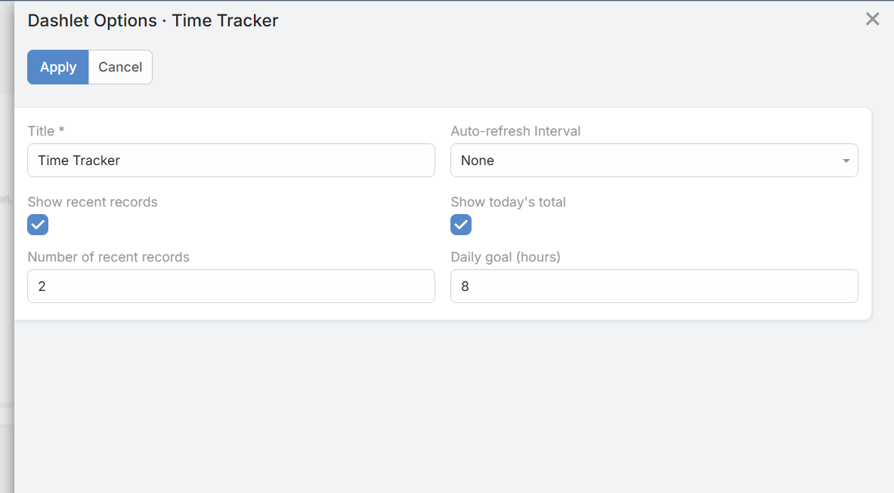

# Dashlets

Das **Time Tracker**-Dashlet ermöglicht es Benutzern, die Arbeitszeit direkt über das EspoCRM-Dashboard zu erfassen und zu überwachen, ohne in einzelne Datensätze navigieren zu müssen.

## Funktionen

* **Schnellsteuerung:** Starten, Überwachen und Stoppen des Timers direkt auf dem Dashboard.
* **Statusanzeige:** Zeigt klar an, ob der Timer aktuell aktiv (`TRACKING`) oder inaktiv (`IDLE`) ist.
* **Kürzliche Einträge:** Schneller Zugriff auf zuletzt erfasste Elemente (z. B. Aufgaben, Fälle oder Verkaufschancen).
* **Tagesziel-Fortschritt:** Zeigt einen Fortschrittsbalken mit der am heutigen Tag erfassten Gesamtzeit im Vergleich zum festgelegten Ziel an (z. B. `0h 0m / 8h`).

## Dashlet-Optionen

Klicken Sie auf das Optionsmenü (`...`) oben rechts auf der Dashlet-Karte, um die Einstellungen anzupassen:

* **Title (Titel):** Benutzerdefinierter Name des Dashlets auf dem Dashboard.
* **Auto-refresh Interval (Auto-Aktualisierungsintervall):** Häufigkeit der automatischen Datenaktualisierung.
* **Show recent records (Kürzliche Einträge anzeigen):** Aktiviert oder deaktiviert die Anzeige der Liste der letzten Datensätze.
* **Number of recent records (Anzahl der kürzlichen Einträge):** Legt fest, wie viele Einträge angezeigt werden.
* **Show today's total (Heutiges Gesamtergebnis anzeigen):** Aktiviert oder deaktiviert den Tagesfortschrittsbalken am unteren Rand der Karte.
* **Daily goal (hours) (Tagesziel in Stunden):** Legt das tägliche Stundenziel fest.
