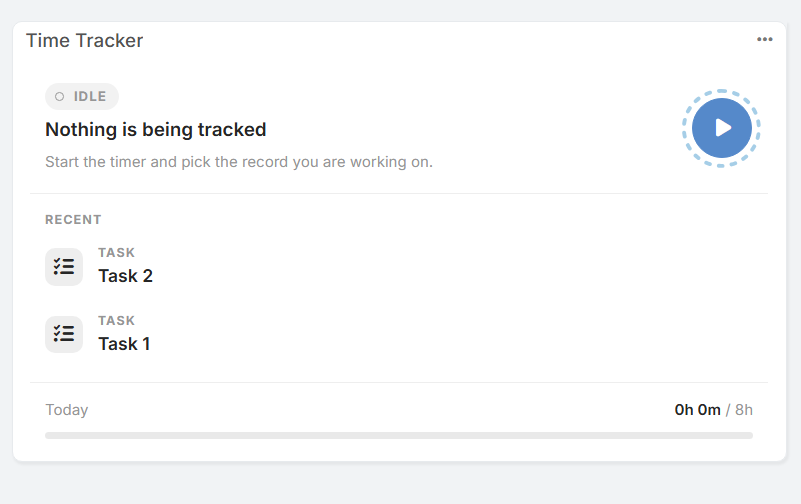
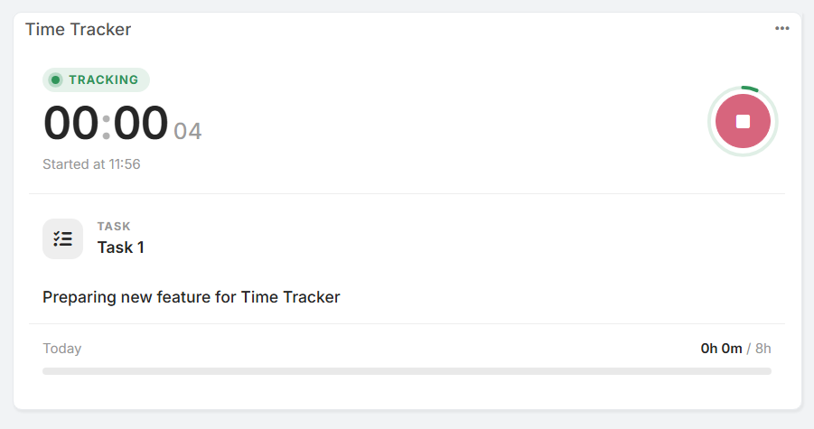
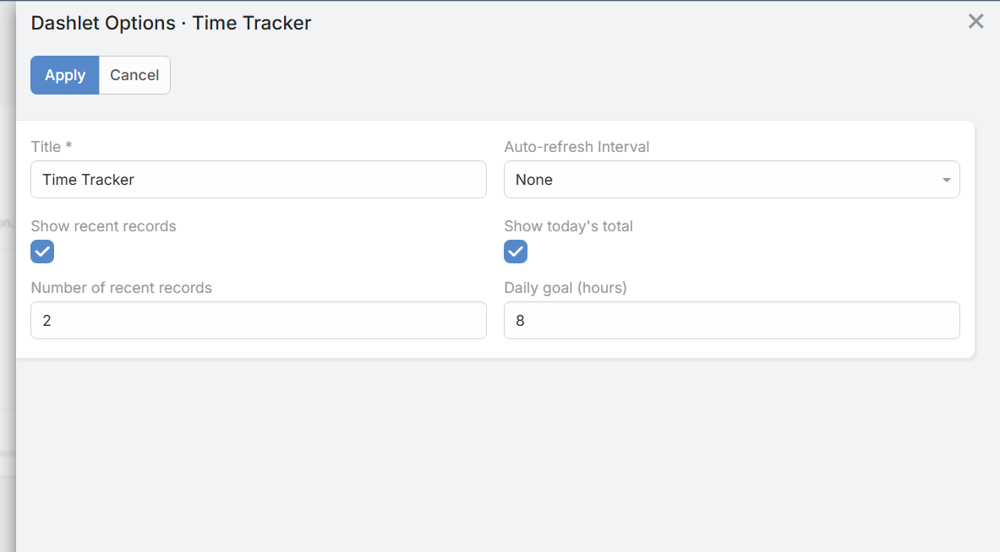

# Dashlets

The **Time Tracker** dashlet allows users to log and monitor work time directly from their EspoCRM dashboard without opening individual entity records.

## Features

* **Quick Control:** Start, monitor, and stop the timer directly from the dashboard card.
* **Status Indicators:** Clearly displays whether the timer is currently active (`TRACKING`) or idle (`IDLE`).
* **Recent Records:** Provides fast access to recently tracked records (such as Tasks, Cases, or Opportunities).
* **Daily Goal Progress:** Displays a progress bar showing total time tracked today against a configured goal (e.g., `0h 0m / 8h`).

## Dashlet Options

Click the options menu (`...`) in the upper-right corner of the dashlet card to configure:

* **Title:** Custom display name for the dashlet on the dashboard.
* **Auto-refresh Interval:** Frequency for updating dashlet data automatically.
* **Show recent records:** Enable or disable the list of recent records.
* **Number of recent records:** Set how many recent items are displayed.
* **Show today's total:** Enable or disable the daily progress bar at the bottom of the card.
* **Daily goal (hours):** Set the target number of working hours per day.
