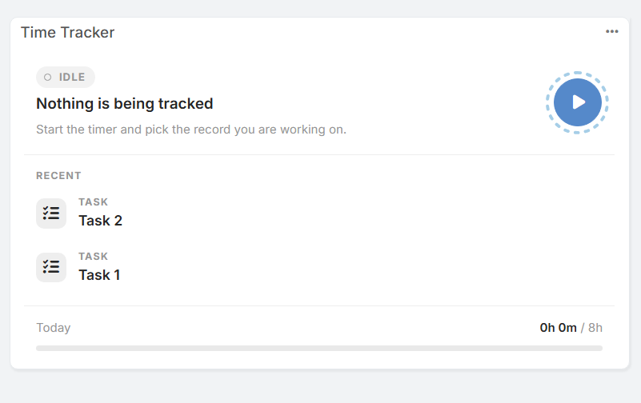
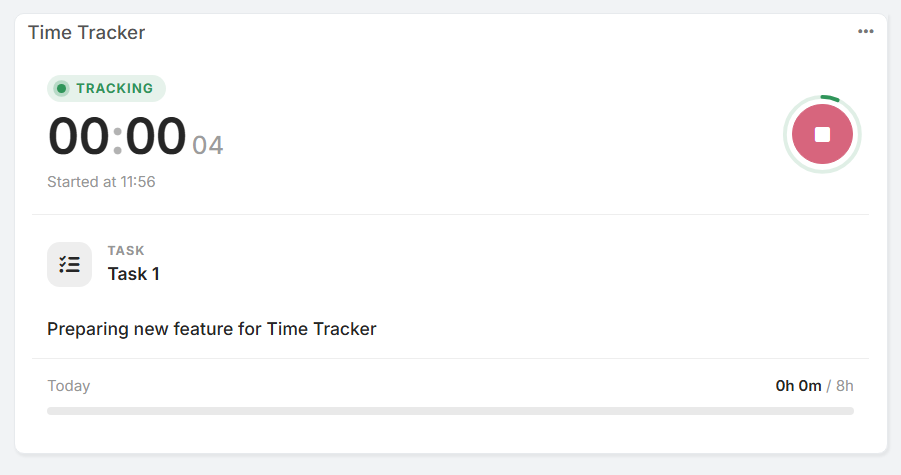
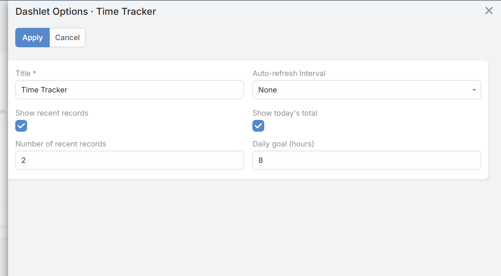

# Dashlety

Dashlet **Time Tracker** umożliwia użytkownikom rejestrowanie i monitorowanie czasu pracy bezpośrednio z poziomu pulpitu EspoCRM, bez konieczności przechodzenia do poszczególnych rekordów.

## Funkcje

* **Szybkie sterowanie:** Uruchamianie, podgląd i zatrzymywanie timera bezpośrednio z karty na pulpicie.
* **Wskaźnik statusu:** Czytelna informacja, czy timer jest w danym momencie aktywny (`TRACKING`), czy bezczynny (`IDLE`).
* **Ostatnie rekordy:** Szybki dostęp do niedawno rejestrowanych obiektów (np. Zadań, Spraw czy Szans).
* **Cel dzienny:** Pasek postępu pokazujący łączny czas zarejestrowany dzisiaj w odniesieniu do ustawionego celu (np. `0h 0m / 8h`).

## Opcje Dashletu

Kliknij menu opcji (`...`) w prawym górnym rogu karty dashletu, aby go skonfigurować:

* **Title (Tytuł):** Własna nazwa dashletu wyświetlana na pulpicie.
* **Auto-refresh Interval (Interwał odświeżania):** Częstotliwość automatycznej aktualizacji danych.
* **Show recent records (Pokaż ostatnie rekordy):** Włącza lub wyłącza wyświetlanie listy ostatnich rekordów.
* **Number of recent records (Liczba ostatnich rekordów):** Określa liczbę wyświetlanych pozycji.
* **Show today's total (Pokaż dzisiejszą sumę):** Włącza lub wyłącza pasek postępu dziennego czasu pracy u dołu karty.
* **Daily goal (hours) (Cel dzienny w godzinach):** Określa docelową liczbę godzin pracy dziennie.
