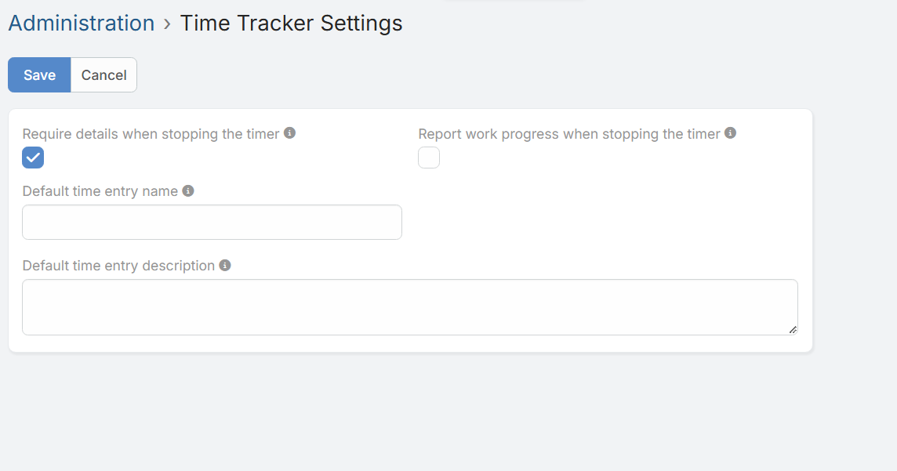
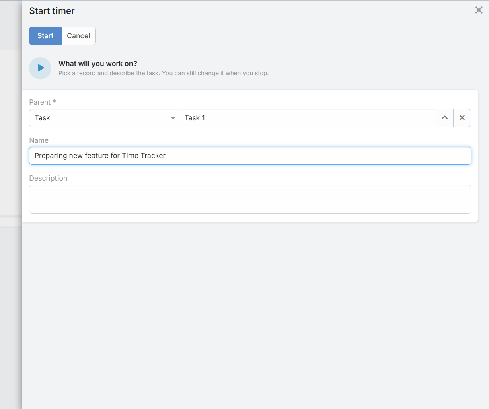

# Time Tracker Einstellungen

Systemadministratoren können das globale Verhalten des Moduls unter **Administration > Time Tracker Settings** anpassen.

## Konfigurationsfelder

### Require details when stopping the timer (Details beim Stoppen des Timers erzwingen)

Wenn aktiviert, müssen Benutzer Name und Beschreibung der durchgeführten Arbeit eingeben, bevor der Timer gestoppt werden kann.

### Report work progress when stopping the timer (Arbeitsfortschritt beim Stoppen des Timers melden)
Fügt dem Stopp-Panel ein Fortschrittsfeld (`%`) hinzu. Der eingegebene Wert wird im Zeiteintrag gespeichert und aktualisiert automatisch den Fortschritt des zugehörigen Arbeitsblatts (Time Sheet).

### Default time entry name (Standardname für Zeiteintrag)
Legt eine Vorlage für den Standardnamen von Zeiteinträgen fest. Lassen Sie das Feld leer, um den Namen des übergeordneten Datensatzes zu verwenden.
* **Verfügbare Platzhalter:** `{parentName}`, `{entityType}`, `{date}`, `{time}`, `{userName}`

### Default time entry description (Standardbeschreibung für Zeiteintrag)
Legt eine Vorlage für die Standardbeschreibung von Zeiteinträgen fest. Lassen Sie das Feld leer, wenn keine Standardbeschreibung verwendet werden soll.
* **Verfügbare Platzhalter:** `{parentName}`, `{entityType}`, `{date}`, `{time}`, `{userName}`
