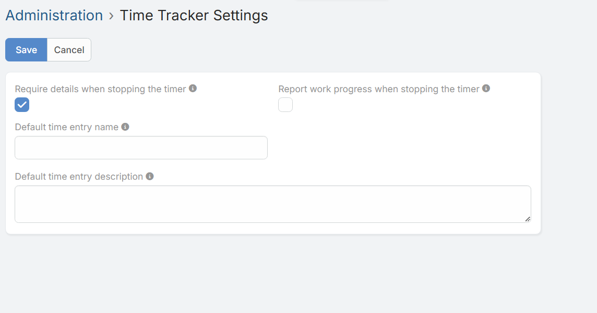
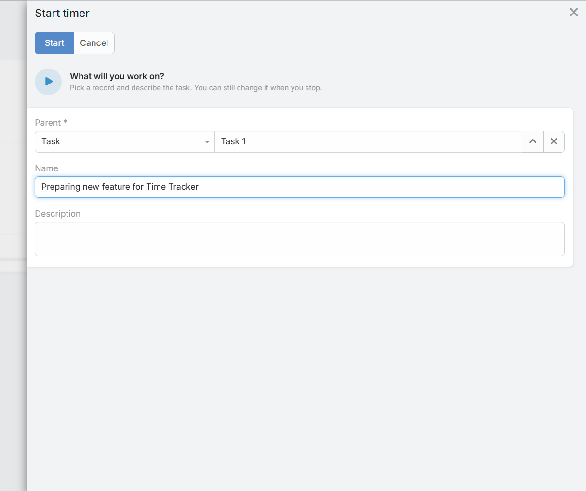

# Time Tracker Settings

System administrators can configure global behavior under **Administration > Time Tracker Settings**.

## Configuration Fields

### Require details when stopping the timer

When enabled, users must enter a name and description of the work performed before the timer can be stopped.

### Report work progress when stopping the timer
Adds a progress (`%`) field to the stop panel. The value is saved on the time entry and automatically updates the progress of the related time sheet.

### Default time entry name
Defines a default template for time entry names. Leave empty to use the record name.
* **Available placeholders:** `{parentName}`, `{entityType}`, `{date}`, `{time}`, `{userName}`

### Default time entry description
Defines a default template for time entry descriptions. Leave empty for no default description.
* **Available placeholders:** `{parentName}`, `{entityType}`, `{date}`, `{time}`, `{userName}`
