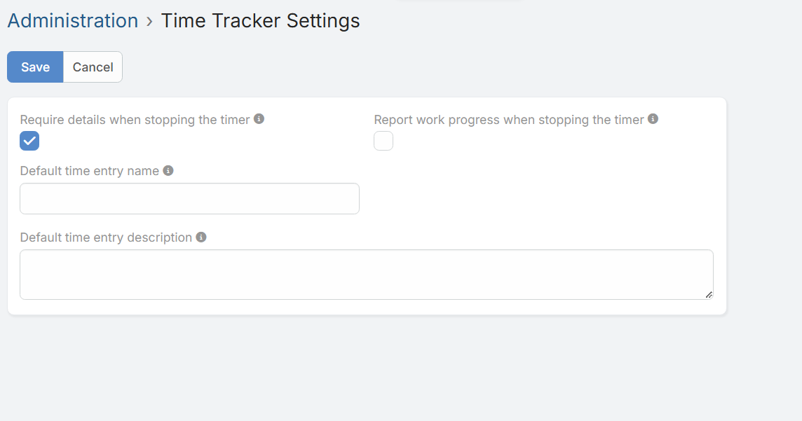
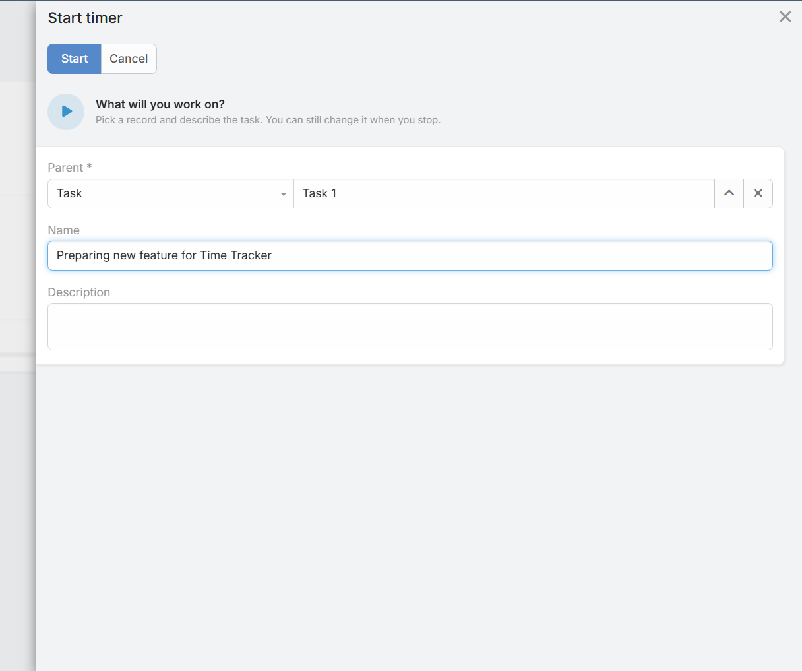

# Ustawienia Time Tracker

Administratorzy systemu mogą skonfigurować globalne zachowanie wtyczki w sekcji **Administration > Time Tracker Settings**.

!!! example "Przekierowanie do ustawień"
    [#Admin/dubasTimeTracker](https://dubas.pro/redirect/#Admin/dubasTimeTracker)

## Pola konfiguracji

### Require details when stopping the timer (Wymagaj szczegółów przy zatrzymywaniu timera)

Po włączeniu tej opcji użytkownicy muszą podać nazwę oraz opis wykonanej pracy przed zatrzymaniem timera.

### Report work progress when stopping the timer (Zgłaszaj postęp prac przy zatrzymywaniu timera)
Dodaje pole postępu (`%`) do panelu zatrzymywania timera. Wartość jest zapisywana we wpisie czasu (Time Entry) oraz automatycznie aktualizuje postęp powiązanego arkusza czasu (Time Sheet).

### Default time entry name (Domyślna nazwa wpisu czasu)
Pozwala ustawić szablon domyślnej nazwy wpisu czasu. Pozostaw puste, aby użyć nazwy rekordu nadrzędnego.
* **Dostępne zmienne (placeholders):** `{parentName}`, `{entityType}`, `{date}`, `{time}`, `{userName}`

### Default time entry description (Domyślny opis wpisu czasu)
Pozwala ustawić szablon domyślnego opisu wpisu czasu. Pozostaw puste, jeśli opis nie ma być generowany domyślnie.
* **Dostępne zmienne (placeholders):** `{parentName}`, `{entityType}`, `{date}`, `{time}`, `{userName}`
